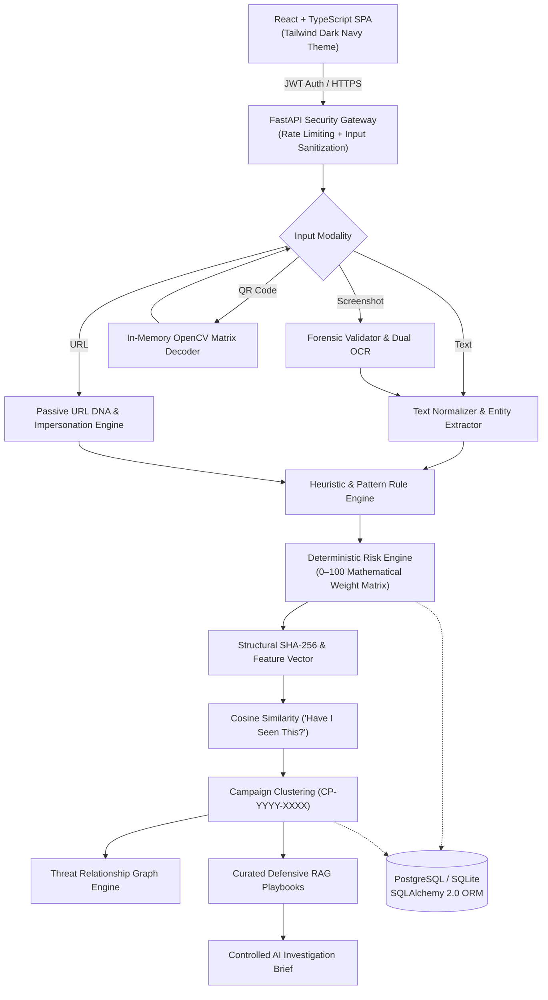

# ProtectPro AI: Multimodal Scam Detection & Threat Intelligence Platform

[](https://www.python.org/)
[](https://fastapi.tiangolo.com/)
[](https://react.dev/)
[](https://www.typescriptlang.org/)
[](https://tailwindcss.com/)
[](LICENSE)

> **"Software and verifiable evidence determine the risk score. The LLM explains the evidence."**

ProtectPro AI is a production-grade, multimodal cybersecurity web application engineered to detect, deconstruct, and investigate fraudulent digital communications, brand impersonation schemes, lookalike domains, and emerging quishing (QR phishing) vectors.

Unlike generic LLM wrappers that guess risk scores and hallucinate assessments, ProtectPro AI utilizes a deterministic, multi-stage inspection pipeline, computer vision, in-memory forensics, and vector similarity clustering to provide an uncheatable, evidence-backed 0–100 risk assessment. An AI agent is used strictly for contextual threat briefing and operator summarization.

---

## Key Features

- **Multimodal Evidence Ingestion:**
  - **Text Inspection:** Adversarial text normalization (zero-width character removal, Cyrillic/Greek homoglyph resolution, leetspeak decoding) and entity extraction.
  - **URL DNA Decomposition:** Passive URL dissection, high-risk TLD scoring, Punycode detection, Shannon hostname entropy, and Levenshtein edit distance brand impersonation detection.
  - **Screenshot Forensics:** Image validation, aspect ratio and dimension inspection, with dual OCR text extraction (`pytesseract` / `easyocr`).
  - **Safe Anti-Quishing (QR Decoding):** In-memory 2D matrix decoding via OpenCV without auto-navigation, network requests, or client execution.
- **Deterministic 0–100 Risk Engine:**
  - Calibrated mathematical weight matrix with non-linear synergy penalties (e.g., Urgency + Credential Request, Lookalike Domain + Financial Brand).
  - Clear risk tiers: `Low` (0–29), `Medium` (30–54), `High` (55–79), and `Critical` (80–100).
- **Temporal Threat Intelligence & Memory:**
  - **Structural Fingerprinting:** SHA-256 canonical hash + 12-dimensional numerical feature vector.
  - **"Have I Seen This Before?" Engine:** L2-normalized cosine similarity search against historical attack signatures.
  - **Automated Campaign Clustering:** Groups related attacks under tracked campaigns (`CP-YYYY-XXXX`) with chronological timelines.
  - **Threat Relationship Graph:** Extracts node-link graphs (Entities, Domains, Brands, Campaigns) formatted for React Flow or D3 visualization.
  - **Curated Defensive RAG:** Retrieves tailored defensive playbooks and remediation steps based on observed threat vectors.
- **Enterprise-Grade Security Hardening:**
  - Sliding-window IP rate limiter (HTTP 429 mitigation).
  - Adversarial prompt injection neutralization and tag scrubbing.
  - Multi-tenant cryptographic isolation with bcrypt password hashing and HS256 JWT sessions.
- **Zero Paid Dependencies:**
  - Operates 100% on free-tier services: Vercel (Frontend), Render (Backend), Neon/Supabase (PostgreSQL), with local SQLite development support.

---

## Empirical Benchmark Performance

Validated against a standardized 12-vector ground-truth evaluation benchmark:

| Metric | Score | Significance |
| :--- | :---: | :--- |
| **Accuracy** | **91.7%** | 11/12 test vectors correctly classified |
| **Precision** | **100.0%** | **0.0% False Positive Rate**: Legitimate business emails never blocked |
| **Recall** | **85.7%** | 6/7 sophisticated attack vectors successfully detected |
| **F1 Score** | **92.3%** | High balance between precision and sensitivity |

---

## System Architecture



---

## Project Structure

```
protectpro-ai/
├── backend/
│   ├── app/
│   │   ├── api/             # REST endpoints (auth, analyses, campaigns, history, evaluation)
│   │   ├── core/            # Security, rate limiting, JWT configuration
│   │   ├── db/              # SQLAlchemy session and database configuration
│   │   ├── evaluation/      # Ground-truth evaluation framework & test vectors
│   │   ├── models/          # 10 database entities (User, Analysis, Campaign, ThreatEntity...)
│   │   ├── schemas/         # Pydantic request/response models
│   │   └── services/        # Multimodal extractors, rule engine, risk scoring, AI agent
│   ├── Dockerfile           # Production container configuration
│   ├── render.yaml          # Render deployment manifest
│   ├── requirements.txt     # Python backend dependencies
│   └── .env.example         # Environment variable template
├── frontend/
│   ├── src/
│   │   ├── pages/           # Landing, Dashboard, Workspace, History, AuthPage
│   │   ├── services/        # Axios API client with automatic JWT handling
│   │   ├── App.tsx          # Client router configuration
│   │   └── index.css        # Tailwind CSS theme with high-contrast accessibility
│   ├── vercel.json          # Vercel SPA routing configuration
│   └── package.json         # React frontend dependencies
├── docs/
│   └── PROTECTPRO_AI_TECHNICAL_REPORT.md  # Comprehensive academic/technical report
└── scripts/
    ├── verify_phase_3.py    # Authentication & isolation test suite
    ├── verify_phase_14.py   # Empirical benchmark verification suite
    └── verify_phase_15.py   # Production pipeline & API readiness test suite
```

---

## Local Setup & Quickstart

### 1. Backend Setup
```bash
cd backend

# Create and activate virtual environment
python -m venv venv
# Windows:
venv\Scripts\activate
# Linux/macOS:
source venv/bin/activate

# Install dependencies
pip install -r requirements.txt

# Run backend development server
uvicorn app.main:app --host 0.0.0.0 --port 8000 --reload
```
Interactive OpenAPI documentation will be live at `http://localhost:8000/docs`.

### 2. Frontend Setup
```bash
cd ../frontend

# Install dependencies
npm install

# Start development server
npm run dev
```
Open `http://localhost:5173` in your browser.

### 3. Running Automated Tests
```bash
# Verify authentication and user isolation
python scripts/verify_phase_3.py

# Verify evaluation benchmarks and metrics
python scripts/verify_phase_14.py

# Verify production optimization and full pipeline
python scripts/verify_phase_15.py
```

---

## Free Cloud Deployment

ProtectPro AI is configured for 100% free hosting using:
1. **Frontend:** [Vercel](https://vercel.com) (configured via `frontend/vercel.json`).
2. **Backend:** [Render](https://render.com) (configured via `backend/render.yaml` or `backend/Dockerfile`).
3. **Database:** [Neon](https://neon.tech) or [Supabase](https://supabase.com) (Free PostgreSQL).

Refer to [`docs/PROTECTPRO_AI_TECHNICAL_REPORT.md`](docs/PROTECTPRO_AI_TECHNICAL_REPORT.md) for full step-by-step cloud deployment instructions and environment variable checklists.

---

## Academic & Interview Defense Documentation

A comprehensive, defense-ready technical report detailing the mathematical formulation of the risk scoring matrix, adversarial resistance, full REST API catalog, and architectural Q&A is located at:
👉 **[`docs/PROTECTPRO_AI_TECHNICAL_REPORT.md`](docs/PROTECTPRO_AI_TECHNICAL_REPORT.md)**

---

## License

This project is licensed under the MIT License — see the [LICENSE](LICENSE) file for details.
